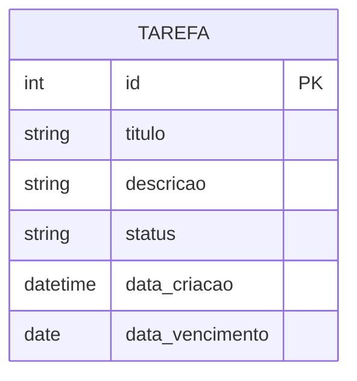

# Diagrama Entidade-Relacionamento (DER)

Como o sistema tem apenas uma entidade, o DER é composto por uma única tabela,
sem relacionamentos com outras entidades.

## Observações

- **PK** = chave primária (Primary Key), gerada automaticamente pelo banco.
- Não há chaves estrangeiras (FK) porque não existe outra entidade no sistema.
- Caso o projeto evolua (por exemplo, adicionando "Usuário" ou "Categoria"),
  bastaria criar uma nova entidade e uma FK `usuario_id` ou `categoria_id`
  dentro de `TAREFA`.
