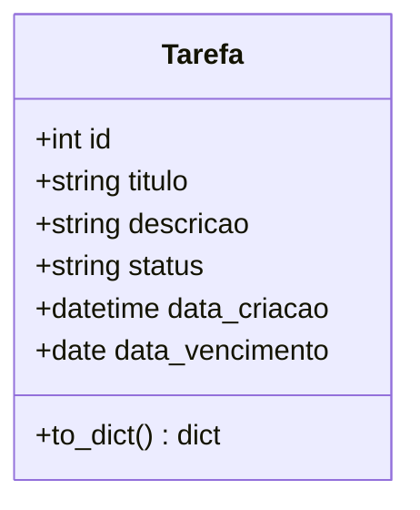

# Diagrama de Classes (UML)

O sistema é bem simples e possui apenas uma classe de negócio: **Tarefa**.

## Descrição da classe

**Tarefa**: representa uma tarefa a ser feita pelo usuário do sistema.

| Atributo | Tipo | Descrição |
|---|---|---|
| id | Integer (PK) | Identificador único da tarefa |
| titulo | String(120) | Nome/título curto da tarefa (obrigatório) |
| descricao | String(500) | Detalhamento opcional da tarefa |
| status | String(20) | "Pendente" ou "Concluída" |
| data_criacao | DateTime | Preenchida automaticamente na criação |
| data_vencimento | Date | Data limite definida pelo usuário (opcional) |

## Relação com o modelo relacional

Como o sistema tem apenas uma entidade, o mapeamento é direto:
a classe `Tarefa` vira a tabela `tarefa` no banco de dados (ver
`schema.sql` e `dicionario_de_dados.md`).
